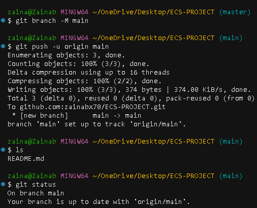
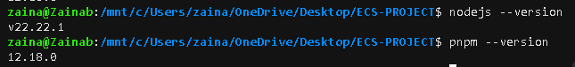
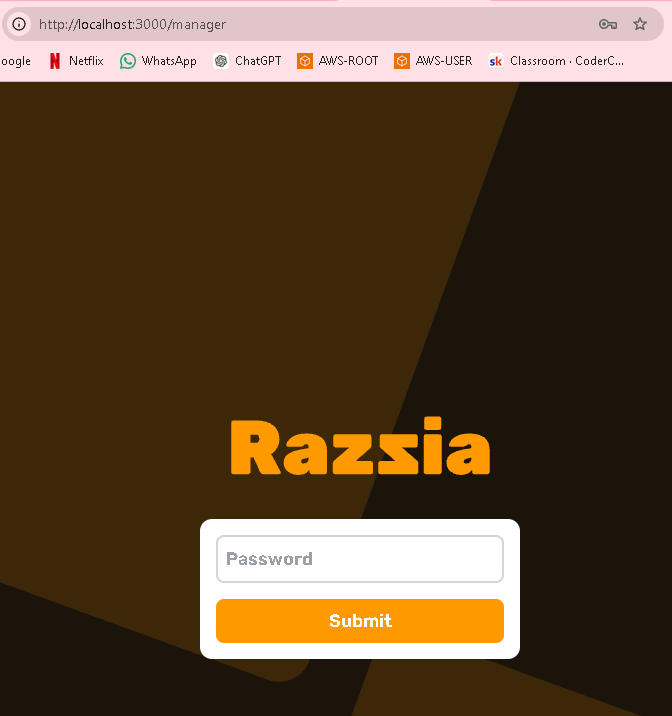
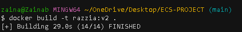
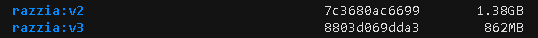
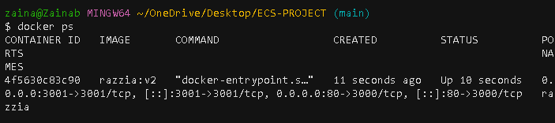
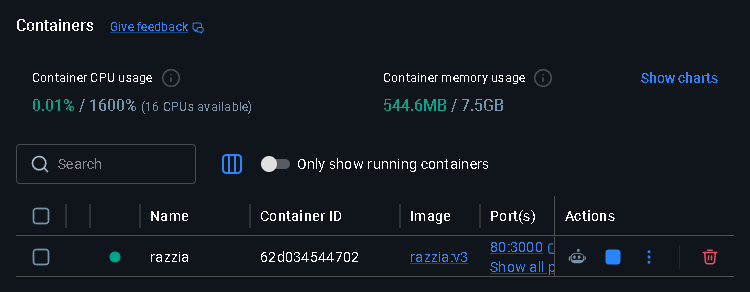
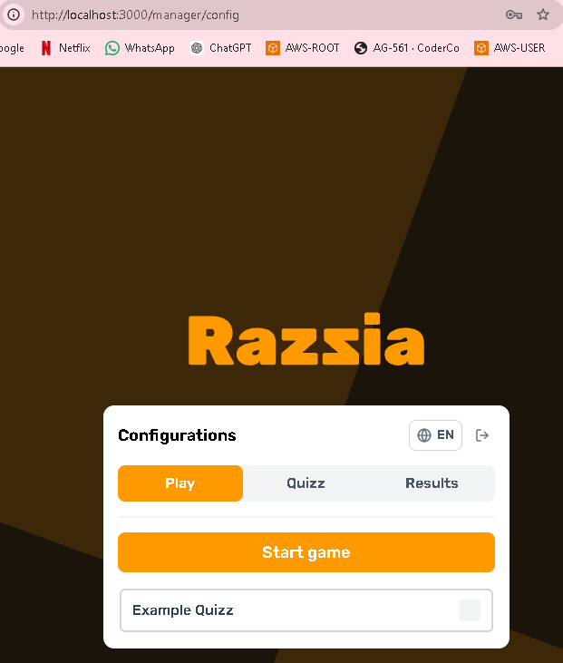
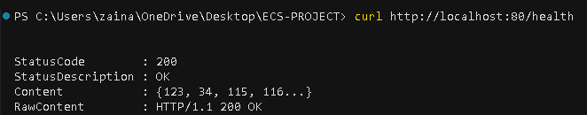
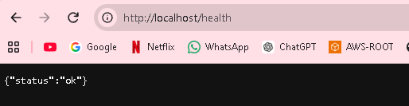

# ECS-PROJECT

## Objective: 

Build, containerise and deploy an application using docker, terraform and ECS, with HTTPS and a custom domain. 

## Table of Contents:

<ENTER TABLE OF ALL THE SECTIONS HERE>
<To create table - view - command palette - search for table of contents and press that>

- [ECS-PROJECT](#ecs-project)
  - [Objective:](#objective)
  - [Table of Contents:](#table-of-contents)
  - [Architecture Overview](#architecture-overview)
  - [Project Structure](#project-structure)
  - [Implementation Walkthrough](#implementation-walkthrough)
    - [01 - Setting up my GitHub remote repo and connecting it to my local git repo for this project:](#01---setting-up-my-github-remote-repo-and-connecting-it-to-my-local-git-repo-for-this-project)
    - [02 - Running my app locally and verifying it](#02---running-my-app-locally-and-verifying-it)
    - [03 - Containerise the App using Docker.](#03---containerise-the-app-using-docker)
      - [Verifying App working:](#verifying-app-working)
    - [04 - Pushing the Docker Image to ECR](#04---pushing-the-docker-image-to-ecr)
    - [05 - AWS Infrastructure to host the application - MANUAL](#05---aws-infrastructure-to-host-the-application---manual)
    - [06 - AWS Infrastructure to host the application - TERRAFORM](#06---aws-infrastructure-to-host-the-application---terraform)
    - [07 - CI/CD Automation](#07---cicd-automation)
    - [08 - HTTPS and Domain Validation](#08---https-and-domain-validation)
  - [App Demo (with HTTPS visible in the browser)](#app-demo-with-https-visible-in-the-browser)
  - [Pipeline Screenshots (all pipelines should show as working)](#pipeline-screenshots-all-pipelines-should-show-as-working)


## Architecture Overview

<ENTER DIAGRAM HERE>


## Project Structure

<ENTER FOLDER STRUCTURE HERE>


## Implementation Walkthrough


### 01 - Setting up my GitHub remote repo and connecting it to my local git repo for this project: 

- `git init`  --> Adds a .git folder which makes it a git repository with all of the dependencies git needs. It contains all the information required for version control.
- `git config --global user.name "zainabx78"`
- `git config --global user.email "Zainabfarooq001@gmail.com"`
- `ssh-keygen -t ed25519 -C "zainabfarooq001@gmail.com" -f ~/.ssh/coderco_key_ecs`
- `cat ~/.ssh/coderco_key_ecs.pub`
- `echo "# ECS-PROJECT" >> README.md `
- `git add .`
- `git commit -m "my first commit"`
- `git branch -M main`
- `git remote add origin https://github.com/zainabx78/ECS-PROJECT.git`
- `git push -u origin main`

    


### 02 - Running my app locally and verifying it

- Using the Razzia app: `https://github.com/Ralex91/Razzia`.
- Razzia is a straightforward and open-source quiz platform, allowing users to host it on their own server for smaller events.
  

- APP PROGRAMMING LANGUAGE: JavaScript/TypeScript - Use node and npm. 
- ENTRYPOINT: `npm run app`


**To use the app locally:** 

  - Need to get the app into a folder. 
  - Need to clone the app repo and then delete the .git folder to remove the connection to the original open source app repo. 

  1. **Use git clone** - clone the application into a new folder called `app`:
    - `git clone https://github.com/Ralex91/Razzia.git app`

  2.  **Remove the .git file: `rm -rf app/.git`**
  

  3. Create a /health route for the app: 
    - `Set-Content -Path app\packages\web\public\health -Value '{"status":"ok"}' -NoNewline`


  4. **Run the application: Locally without docker:**

  - The app requires Node.js 24 and pnpm 10.16+
    - I used **Windows PowerShell** for every step. I originally mixed it with the Ubuntu/WSL terminal, which caused broken installs, so I stuck to one.

    - I installed pnpm:
      - `npm install -g pnpm`

    - I installed Node.js 24:
      - I downloaded the Windows Installer for version 24 from https://nodejs.org and ran it
      - I restarted my computer so the new version was picked up

    - I checked the versions:
      - `node --version` - this needs to show **v24**. I was on v22 at first, which made the build fail with a "Cannot find native binding" error.
      - `pnpm --version`

    

    - I added the env variable needed:
      - `cd app`
      - `copy .env.example .env`
      - `notepad .env` - set `MANAGER_PASSWORD=<password>` (no spaces or quotes) and save.
   

    - Cleaned out the old, broken install (needed because installed before upgrading to Node 24):
      - `Remove-Item -Recurse -Force node_modules, packages\*\node_modules -ErrorAction SilentlyContinue`

    - Running the app:
      - `pnpm install`
      - `pnpm build`
      - `pnpm start` - Kept this window open while using the app


    - As the host: 
      - URL: `http://localhost:3000/manager` 
      - Asks for the password set in the env file - `MANAGER_PASSWORD`.

      

    - As a player, I went to http://localhost:3000 and entered the PIN from the host to join a game.


### 03 - Containerise the App using Docker.
 **Run the application: Locally with Docker:**

  - Create a dockerfile: 
      - Start with the slim image - make it run and work, and then try a smaller image after (distroless).

**IMPROVED DOCKERFILE:** NO MULTISTAGE BUILD

- Includes:
  - Non-root user
  - multi-stage, with no build tools in final stage.

**SECRET MANAGEMENT:**
**- No secrets in the dockerfile - saved in .env file and given in docker run command instead.**


```dockerfile

FROM node:24-slim

WORKDIR /app

COPY app/ .

RUN apt-get update && apt-get install -y libatomic1 && rm -rf /var/lib/apt/lists/*

RUN npm install -g pnpm

RUN --mount=type=cache,id=pnpm,target=/pnpm/store pnpm install --frozen-lockfile

RUN pnpm build

# Running as non-root user
RUN groupadd -r app && useradd -r -m -g app app && chown -R app:app /app
USER app

# The port the application uses inside container - just for documentation.
EXPOSE 3000

CMD ["pnpm", "start"]

```

  - `docker build -t razzia:v2 .` -> building the image.
  
  


  - `docker images` -> shows build image. 
  - `docker run -d --name razzia --env-file app/.env -p 80:3000 -p 3001:3001 razzia:v2`
  - Go to `http://localhost:80/manager` 


**IMPROVED DOCKERFILE:** MULTI-STAGE BUILD:

```dockerfile

# Stage 1 - Build Stage
FROM node:24-slim as Build 

WORKDIR /app

COPY app/ .

RUN apt-get update && apt-get install -y libatomic1 && rm -rf /var/lib/apt/lists/*

RUN npm install -g pnpm

RUN --mount=type=cache,id=pnpm,target=/pnpm/store pnpm install --frozen-lockfile


RUN pnpm build


# Stage 2 - Production stage
FROM node:24-slim

WORKDIR /app

COPY --from=build /app /app

RUN apt-get update && apt-get install -y libatomic1 && rm -rf /var/lib/apt/lists/*

RUN npm install -g pnpm

# Running as non-root user
RUN groupadd -r app && useradd -r -m -g app app && chown -R app:app /app
USER app

# The port the application uses inside container - just for documentation.
EXPOSE 3000

CMD ["pnpm", "start"]


```
- Delete old v3 image and container - `docker rmi` and `docker rm`.
- `docker build -t razzia:v3 .` 
- `docker run -d --name razzia --env-file  app/.env -p 80:3000 -p 3001:3001 razzia:v3`

**Multi-stage build vs normal build:**

- The size has reduced!


#### Verifying App working: 

**Docker container running:**



**Running in Docker desktop:**



- App working: Lets me login with the password:



**Verification that the app is running -->**
  - `curl http://localhost:80/health`



- `/health` in browser - configured it at the start when git cloned the app.
- `http://localhost:80`



### 04 - Pushing the Docker Image to ECR


### 05 - AWS Infrastructure to host the application - MANUAL 


### 06 - AWS Infrastructure to host the application - TERRAFORM

### 07 - CI/CD Automation 

### 08 - HTTPS and Domain Validation


## App Demo (with HTTPS visible in the browser)


## Pipeline Screenshots (all pipelines should show as working)