# ECS-PROJECT

## Objective: 

Build, containerise and deploy an application using docker, terraform and ECS, with HTTPS and a custom domain. 

## Table of Contents:

<ENTER TABLE OF ALL THE SECTIONS HERE>
<To create table - view - command palette - search for table of contents and press that>

- [ECS-PROJECT](#ecs-project)
  - [Objective:](#objective)
  - [Table of Contents:](#table-of-contents)
  - [Architecture Overview](#architecture-overview)
  - [Project Structure](#project-structure)
  - [Implementation Walkthrough](#implementation-walkthrough)
    - [01 - Setting up my GitHub remote repo and connecting it to my local git repo for this project:](#01---setting-up-my-github-remote-repo-and-connecting-it-to-my-local-git-repo-for-this-project)
    - [02 - Running my app locally and verifying it](#02---running-my-app-locally-and-verifying-it)
    - [03 - Containerise the App using Docker.](#03---containerise-the-app-using-docker)
      - [Verifying App working:](#verifying-app-working)
    - [04 - Pushing the Docker Image to ECR](#04---pushing-the-docker-image-to-ecr)
    - [05 - AWS Infrastructure to host the application - MANUAL](#05---aws-infrastructure-to-host-the-application---manual)
    - [06 - AWS Infrastructure to host the application - TERRAFORM](#06---aws-infrastructure-to-host-the-application---terraform)
    - [1. Make sure Route53 Hosted Zone is created.](#1-make-sure-route53-hosted-zone-is-created)
    - [2. Create the remote state bucket (first time only)](#2-create-the-remote-state-bucket-first-time-only)
    - [3. Connect the main project to the S3 backend](#3-connect-the-main-project-to-the-s3-backend)
    - [4. Deploy](#4-deploy)
    - [5. Push the app to the ecr repo through the CLI.](#5-push-the-app-to-the-ecr-repo-through-the-cli)
    - [6. Check app works (Verification) on custom DNS host name: `https://aws.zainabf.co.uk`](#6-check-app-works-verification-on-custom-dns-host-name-httpsawszainabfcouk)
  - [Tearing it down](#tearing-it-down)
    - [07 - CI/CD Automation - Github Actions](#07---cicd-automation---github-actions)
    - [08 - HTTPS and Domain Validation](#08---https-and-domain-validation)
  - [App Demo (with HTTPS visible in the browser)](#app-demo-with-https-visible-in-the-browser)
  - [Pipeline Screenshots (all pipelines should show as working)](#pipeline-screenshots-all-pipelines-should-show-as-working)


## Architecture Overview

<ENTER DIAGRAM HERE>


## Project Structure

<ENTER FOLDER STRUCTURE HERE>


## Implementation Walkthrough


### 01 - Setting up my GitHub remote repo and connecting it to my local git repo for this project: 

- `git init`  --> Adds a .git folder which makes it a git repository with all of the dependencies git needs. It contains all the information required for version control.
- `git config --global user.name "zainabx78"`
- `git config --global user.email "Zainabfarooq001@gmail.com"`
- `ssh-keygen -t ed25519 -C "zainabfarooq001@gmail.com" -f ~/.ssh/coderco_key_ecs`
- `cat ~/.ssh/coderco_key_ecs.pub`
- `echo "# ECS-PROJECT" >> README.md `
- `git add .`
- `git commit -m "my first commit"`
- `git branch -M main`
- `git remote add origin https://github.com/zainabx78/ECS-PROJECT.git`
- `git push -u origin main`

    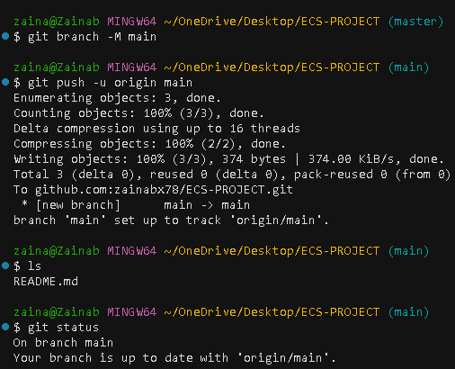


<br/><br/>
### 02 - Running my app locally and verifying it

- Using the Razzia app: `https://github.com/Ralex91/Razzia`.
- Razzia is a straightforward and open-source quiz platform, allowing users to host it on their own server for smaller events.
  

- APP PROGRAMMING LANGUAGE: JavaScript/TypeScript - Use node and npm. 
- ENTRYPOINT: `npm run app`


<br/><br/>
**To use the app locally:** 

  Need to get the app into a folder. 
  Need to clone the app repo and then delete the .git folder to remove the connection to the original open source app repo. 

  1. **Use git clone** - clone the application into a new folder called `app`:
    - `git clone https://github.com/Ralex91/Razzia.git app`

  2.  **Remove the .git file: `rm -rf app/.git`**
  

  3. Create a /health route for the app: 
    - `Set-Content -Path app\packages\web\public\health -Value '{"status":"ok"}' -NoNewline`


  4. **Run the application: Locally without docker:**

  - The app requires Node.js 24 and pnpm 10.16+
    - I used **Windows PowerShell** for every step. I originally mixed it with the Ubuntu/WSL terminal, which caused broken installs, so I stuck to one.

    - I installed pnpm:
      - `npm install -g pnpm`

    - I installed Node.js 24:
      - I downloaded the Windows Installer for version 24 from https://nodejs.org and ran it
      - I restarted my computer so the new version was picked up

    - I checked the versions:
      - `node --version` - this needs to show **v24**. I was on v22 at first, which made the build fail with a "Cannot find native binding" error.
      - `pnpm --version`

    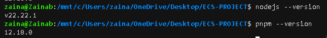

    - I added the env variable needed:
      - `cd app`
      - `copy .env.example .env`
      - `notepad .env` - set `MANAGER_PASSWORD=<password>` (no spaces or quotes) and save.
   

    - Cleaned out the old, broken install (needed because installed before upgrading to Node 24):
      - `Remove-Item -Recurse -Force node_modules, packages\*\node_modules -ErrorAction SilentlyContinue`

    - Running the app:
      - `pnpm install`
      - `pnpm build`
      - `pnpm start` - Kept this window open while using the app


    - As the host: 
      - URL: `http://localhost:3000/manager` 
      - Asks for the password set in the env file - `MANAGER_PASSWORD`.

      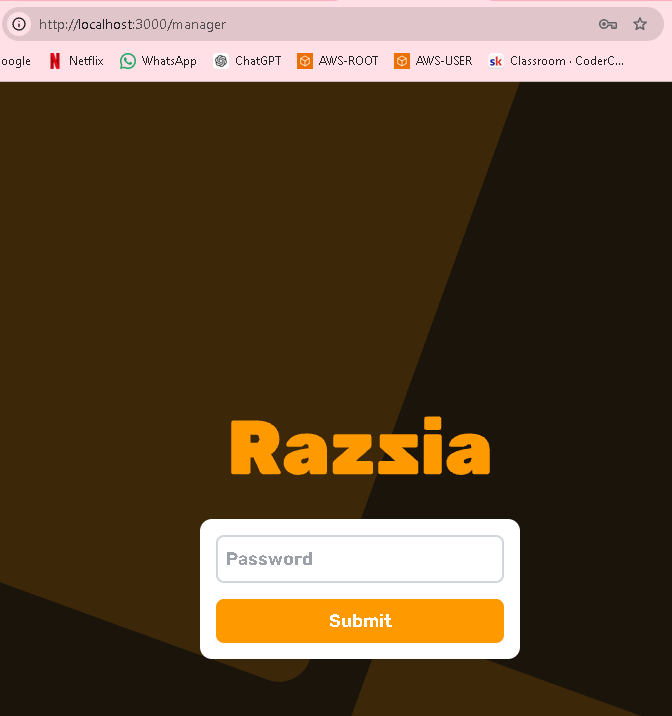

    - As a player, I went to http://localhost:3000 and entered the PIN from the host to join a game.


<br/><br/>

### 03 - Containerise the App using Docker.
 **Run the application: Locally with Docker:**

  - Create a dockerfile: 
      - Start with the slim image - make it run and work, and then try a smaller image after (distroless).

  - Image choice: 
      - I used node:24-slim rather than Alpine because the app depends on native binaries (rolldown, Tailwind, pnpm) that are built for glibc, and Alpine’s musl library can cause compatibility issues. Slim keeps the image small while staying compatible.

**IMPROVED DOCKERFILE:** NO MULTISTAGE BUILD

- Includes:
  - Non-root user
  - multi-stage, with no build tools in final stage.

**SECRET MANAGEMENT:**
**- No secrets in the dockerfile - saved in .env file and given in docker run command instead.**


```dockerfile

FROM node:24-slim

WORKDIR /app

COPY app/ .

RUN apt-get update && apt-get install -y libatomic1 && rm -rf /var/lib/apt/lists/*

RUN npm install -g pnpm

RUN --mount=type=cache,id=pnpm,target=/pnpm/store pnpm install --frozen-lockfile

RUN pnpm build

# Running as non-root user
RUN groupadd -r app && useradd -r -m -g app app && chown -R app:app /app
USER app

# The port the application uses inside container - just for documentation.
EXPOSE 3000

CMD ["pnpm", "start"]

```

  - `docker build -t razzia:v2 .` -> building the image.
  
  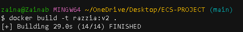


  - `docker images` -> shows build image. 
  - `docker run -d --name razzia --env-file app/.env -p 80:3000 -p 3001:3001 razzia:v2`
  - Go to `http://localhost:80/manager` 


<br/><br/><br/><br/>

**IMPROVED DOCKERFILE:** MULTI-STAGE BUILD:

```dockerfile
# Stage 1: build stage
FROM node:24-slim as Build

# work out of /app
WORKDIR /app

# bring in the app code
COPY app/ .

# pnpm crashes without libatomic on slim
RUN apt-get update && apt-get install -y libatomic1 && rm -rf /var/lib/apt/lists/*

# install pnpm
RUN npm install -g pnpm

# install deps, cache the store so rebuilds are quicker
RUN --mount=type=cache,id=pnpm,target=/pnpm/store pnpm install --frozen-lockfile

# build the app
RUN pnpm build


# Stage 2: production stage
FROM node:24-slim

# same working folder
WORKDIR /app

# grab the built app from the build stage
COPY --from=build /app /app

# need libatomic again since this stage starts from scratch
RUN apt-get update && apt-get install -y libatomic1 && rm -rf /var/lib/apt/lists/*

# and pnpm for the start command
RUN npm install -g pnpm

# make a non-root user and give it the app files
RUN groupadd -r app && useradd -r -m -g app app && chown -R app:app /app

# don't run as root
USER app

# web port
EXPOSE 3000

# start it up
CMD ["pnpm", "start"]

```
- Delete old v3 image and container - `docker rmi` and `docker rm`.
- `docker build -t razzia:v3 .` 
- `docker run -d --name razzia --env-file  app/.env -p 80:3000 -p 3001:3001 razzia:v3`
  
<br/><br/><br/><br/>

**Multi-stage build vs normal build:**

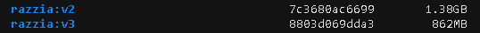
- The size has reduced!

<br/><br/><br/><br/>

#### Verifying App working: 

**Docker container running:**
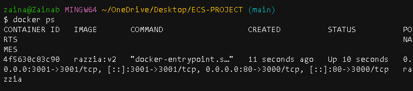


**Running in Docker desktop:**
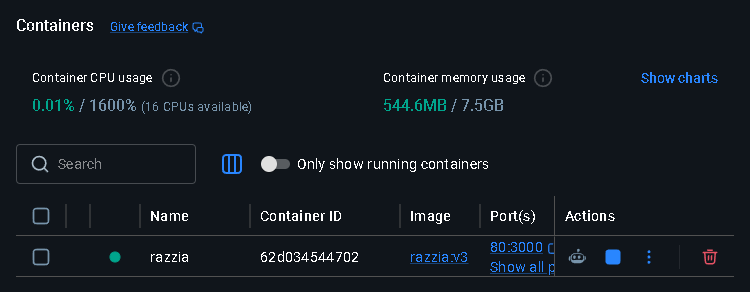


- App working: Lets me login with the password:
  <br/><br/>

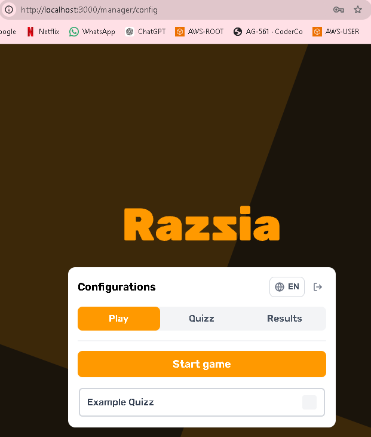

<br/><br/><br/><br/>

**Verification that the app is running -->**
  - `curl http://localhost:80/health`
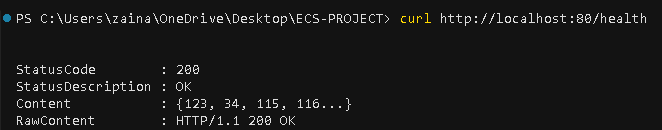


- `/health` in browser - configured it at the start when git cloned the app.
- `http://localhost:80`
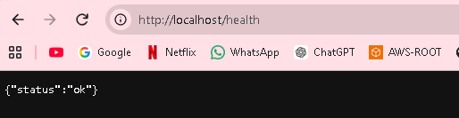


<br/><br/>
<br/><br/>

### 04 - Pushing the Docker Image to ECR

- Need to push the built image into ECR: 

1. Create a private ECR repository in AWS. I called mine `razzia`.
2. View push commands in console:
   
3. `aws ecr get-login-password --region eu-west-2 | docker login --username AWS --password-stdin 843447001879.dkr.ecr.eu-west-2.amazonaws.com`
4. Build image - mine is already built. 
5. `docker tag razzia:v3 843447001879.dkr.ecr.eu-west-2.amazonaws.com/razzia:v3` -> tag the image 
6. `docker push 843447001879.dkr.ecr.eu-west-2.amazonaws.com/razzia:v3` -> push the image to ECR.


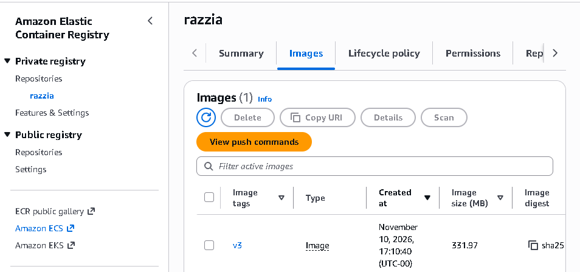


**- VERIFICATION:**
- `aws ecs describe-repositories`
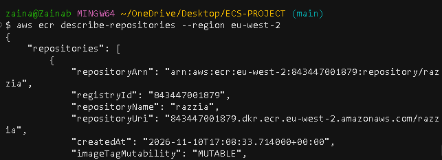


<br/><br/>
<br/><br/>


### 05 - AWS Infrastructure to host the application - MANUAL 


**Setting up the Networking:**

**The underlying network architecture:**

  - **Internet Gateway** -> Allows AWS services to have access to the public internet.

  - **2 Public Subnets** -> An ALB requires subnets in at least two different Availability Zones.
    - Route table associated: to route all outbound traffic to the Internet Gateway.

  - **1 Private Subnet** -> The ECS cluster will be sitting in this subnet - private application.
    - Must be in the same Availability Zone as one of the public subnets, otherwise the ALB can't reach it.
    - Route table associated: Routes all outbound internet traffic (0.0.0.0/0) to the NAT gateway.

  - **NAT Gateway** -> In the public subnet. This ensures the private application can access the public internet for package installations and updates etc. 

  - **Application Load balancer** -> For routing traffic to the private ECS containerised application. Configured below.

  - **2 Security Groups:**
    - Application Load Balancer SG -> Allows traffic in from the outside (http and https).
    - ECS Service (container) SG -> Allows traffic in on port 3000 from the ALB's SG only. (Private and secure).


<br/><br/>
<br/><br/>

**Actual Deployment:**


1. **Set up an ALB (Application Load Balancer)**
    - Will be associated with the 2 public subnets. 
    - `razzia-app-load-balancer`
    - Internet facing
  
    - Networking - 
      - Use the same VPC as the application.
      - Select the 2 public subnets. 
      - Create a new security group -> allows http and https traffic. 
  
    - Listeners and routing:
      - Create a new listener
        - Protocol HTTP -> port 80. 
        - Routing action = forward to target group. 
  
      - Create a new target group:
        - Target type = IP addresses
        - Protocol = HTTP
        - Port = 3000 (same as the ECS Task definition later on).
          - This is because this specifies which door the load balancer needs to knock on to get to the application. 
          - The task definition specifies which door the app opens. 
        - No targets need to be registered, because once the load balancer is associated with ECS, the tasks/containers ECS spins up will be automatically added to the targets of the load balancer. 


2. Create an ECR repository - already created in previous step.
  - Private repo - called `razzia`
  - My image is saved in here from the previous step.  


3. Create an ECS Cluster (I recommend Fargate)
  - With Fargate launch type, all you need to do is package your application in containers, specify the memory and CPU requirements, define IAM policies & launch your application. 
  - Created a new Fargate ECS cluster called `razzia-cluster`


4. Create a Task Definition for your container (instructions for the container)
  - The task definition is a text file, in JSON format, that describes one or more containers that form application. This is like a blueprint for the application.
  - `razzia-task-definition`
  - Launch type = AWS Fargate
  
  - Task role: 
    - This role will allow the ECS task to call AWS services on my behalf.
    - Only need to create this if the app calls on AWS services - leave empty for now. 

<br/><br/>

**- To add the secret in (password for app):**
   - Leave the ECS tab open, open a new AWS tab. 
   - Create a secret in AWS Secrets Manager
   - Other type of secret --> store password as plain text. 
  
```json
{
    "MANAGER_PASSWORD": "<password>"
}
```
   - Name: `razzia-app-password`

  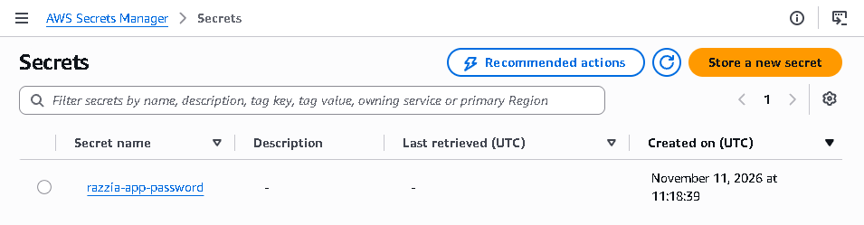

<br/><br/>

- Then, need to add this secret ARN into the role in task definition

  - Create a new role - Task execution role :  
    - Need the `AmazonECSTaskExecutionRolePolicy` policy attached to the role -> this is usually attached by default when creating a new role in the task definition page. 
      - This policy ensures ECS can download the app’s container image from ECR and write the app’s logs to CloudWatch.
  
    - Add additional new policy
      - `ecsTaskExecutionRolePassword`
      - This name can be anything -> recommend using something clearer like `razzia-secret-access`
      - This will allow ECS to read the password for the application from AWS Secrets Manager.

```
{
	"Version": "2012-10-17",
	"Statement": [
		{
			"Effect": "Allow",
			"Action": "secretsmanager:GetSecretValue",
			"Resource": "arn:aws:secretsmanager:eu-west-2:843447001879:secret:razzia-app-password-VRLdYe"
		}
	]
}
```
<br/><br/>

- Then, add ARN to task definition:
  - Add env variable - key MANAGER_PASSWORD.
  - Value type = ValueFrom
  - Value = the secret ARN with specified secret at the end:

```
arn:aws:secretsmanager:eu-west-2:843447001879:secret:razzia-app-password-VRLdYe:MANAGER_PASSWORD::
```

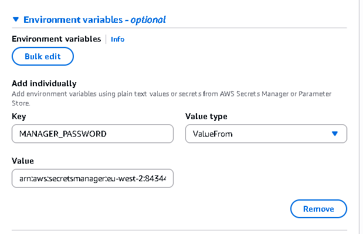


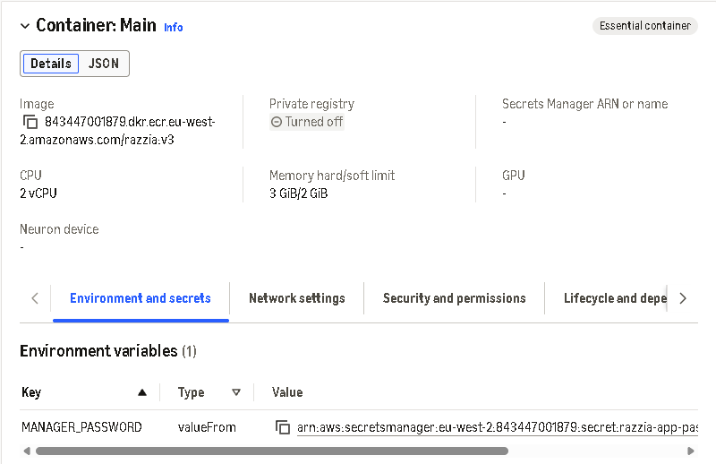

<br/><br/>

Add image from ECR repo - previously created 

  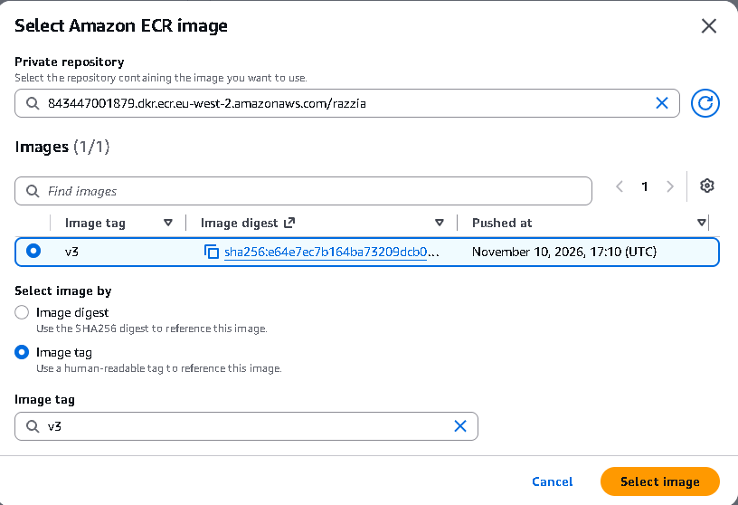

<br/><br/>

**Add the correct port mappings for the ECS task definition:**
  - The app listens on port 3000 inside the container, and AWS exposes it on port 3000 too. 
  - With Fargate, both numbers are always the same. This is the number the target group (in the load balancer) must match.
  - This is because the task definition port is the port that the application opens inside the container. 
  - App protocol (http): tells AWS the app speaks normal web traffic. This is what's used for a website. 

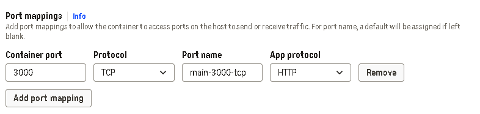

<br/><br/>

5. **Create a service (run container)** -> In ECS cluster - create service. 
  - This will actually provision the container using that image in the task definition. 
  - `Run task` = quick for testing purposes - no load balancer allowed.
  - `Create service` = keeps container running and can put a load balancer infront. 
  
  - Compute option -> Launch type - fargate
  - Create this using the private subnet. 
  - Create a new security group -> Allows inbound traffic on port 3000 from the load balancer's security group. 
  - No public IP - As it's a private application.
  

<br/><br/>

  **Linking the load balancer to ECS:**
  - Still creating the service - additional option of load balancing within the configuration steps.
  - Load balancing -> Use the existing load balancer previously created:
    - Load balancer = `razzia-app-load-balancer`
    - Listener = Use an existing listener -> 80:HTTP
    - Target group = Use an existing target group -> port 3000 one created in step 1


`Visitor (internet traffic) → listener (port 80) → target group (port 3000) → ECS task (container port 3000)`


<br/><br/>


**Generic workflow:**

    PUBLIC INTERNET TRAFFIC

    HITS THE ALB Listener

    ALB INTERNALLY DIRECTS ALL TRAFFIC THAT HITS IT TO THE ECS CONTAINERS IN THE PRIVATE NETWORK - target group 

    TRAFFIC IS ROUTED TO THE APPLICATION - ecs container service


<br/><br/>


6. **SETTING UP HTTPS AND CUSTOM DOMAIN**

- First set it up in Route 53

  - Create a hosted zone using a subdomain of my custom domain:
    - `aws.zainabf.co.uk`

  - Create an Alias record (Type A, Alias on)
  - Route traffic to the Application Load Balancer I created previously.

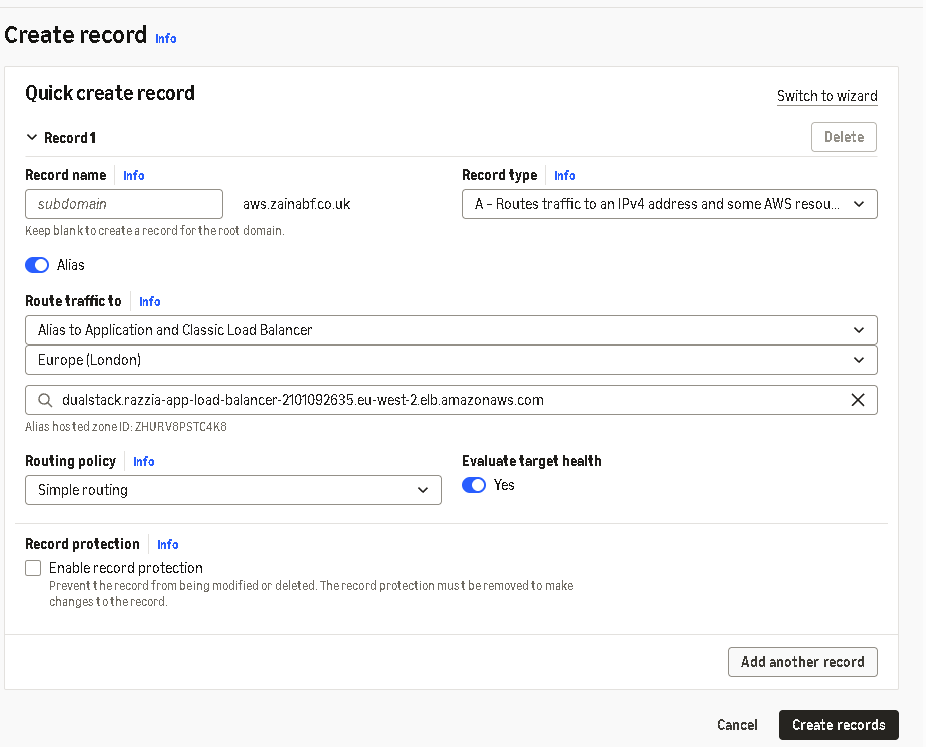

- Add the Route 53 name servers to Cloudflare so the subdomain points to AWS:
  - Copy the four name servers from the hosted zone's NS record. They look like ns-123.awsdns-45.com.
  - In Cloudflare: go to the domain → DNS → Records and add four records:
    - Type: NS
    - Name: aws
    - Content: one of the four Route 53 name servers (one record per name server)

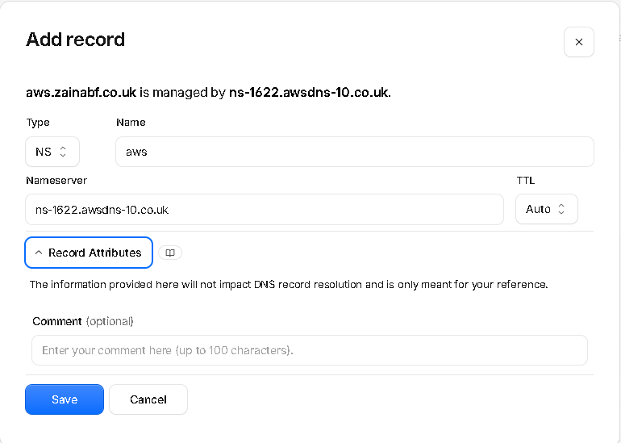

<br/><br/>

**STEPS FOR HTTPS:** Adding HTTPS listener

- Update the load balancer and add an HTTPS listener (HTTP already configured)

  - Go to load balancer
  - Add listener
  - Protocol: HTTPS, port 443
  - Forward to the same target group as HTTP
  - In the certificate area → request a new ACM certificate

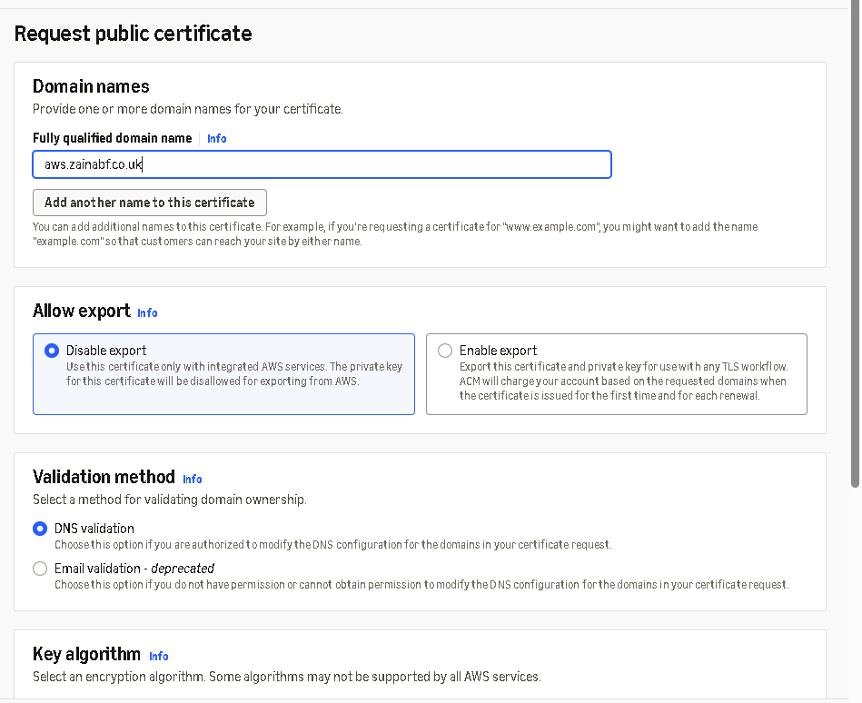

  - Certificate settings:
    - Domain name: `aws.zainabf.co.uk` (the custom hostname set up above)
    - Validation method: DNS validation
  - In ACM, click **Create records in Route 53** to add the validation record
  - Wait for the certificate status to show **Issued**
  - Attach the ACM certificate to the HTTPS listener

- Make sure the load balancer's security group allows inbound HTTPS (port 443)

- Redirect the HTTP (port 80) listener so any traffic hitting HTTP goes to HTTPS:
  - Go to the HTTP listener on the load balancer
  - Routing action: Redirect to URL
  - Protocol: HTTPS, Port: 443
  - Status code: 301 - Permanently moved

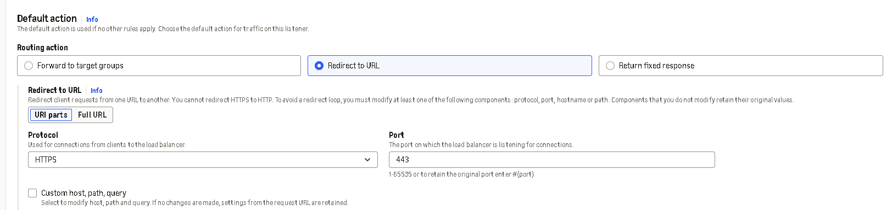

  - Now when I go to http://aws.zainabf.co.uk, it automatically takes me to HTTPS instead.

- Check the custom domain URL and see the app being load balanced there instead of the ALB URL.

`https://aws.zainabf.co.uk` → should see the application.

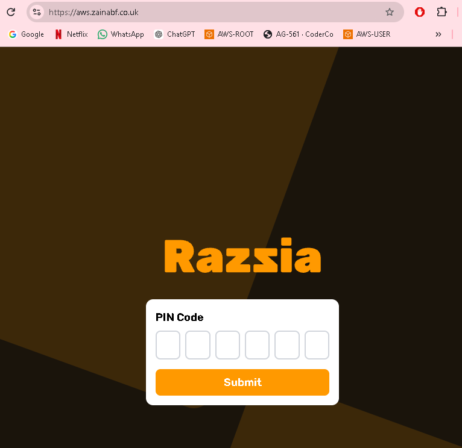

```
Visitor → HTTPS listener (port 443, uses my ACM cert)
→ target group (port 3000)
→ ECS task (port 3000)

Visitor → HTTP listener (port 80) → redirect to HTTPS
```

<br/><br/>

**Load balancer resource map:**

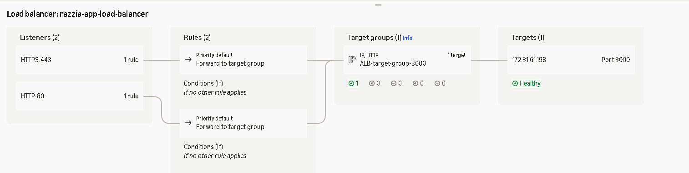

<br/><br/>
<br/><br/>


### 06 - AWS Infrastructure to host the application - TERRAFORM

1. Created a folder for terraform called `terraform` within this repository. 
2. Create a `README.md` and `main.tf` file within that folder. 

3.   Then, create modules and create all the infrastructure I created manually above, but this time in terraform. 
   Terraform commands:
   - `terraform init`
   - `aws configure` -> ensure user has permissions and use access keys. Connect terraform to AWS account. 
   - `terraform plan`
   - `terraform apply` or `terraform apply --auto-approve`
  

  E.g. `terraform plan`
  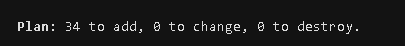

4. Referencing the secret (password) the app uses within terraform:
  - I used terraform.tfvars for this. 
  - Defined the variable in root variables.tf file, the value was in terraform.tfvars and then I referenced it in the ecs module. 

5. S3 Backend 
   - Configure bootstrap folder in the root of the terraform folder.
     - It should have everything to run independently from other terraform infrastructure.
     - Run this bootstrap folder to create an s3 bucket for the backend.
   - The main terraform files -> provider.tf -> Includes the reference to a S3 backend: `backend "s3" {}`
     - Once bootstrap backend is created, do `terraform init -backend-config=backend.hcl -migrate-state` in the root of the terraform folder - where all the modules/main terraform files etc are. 

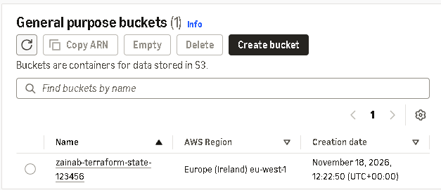

6. Terraform folder structure


```
terraform/
├── bootstrap/                # One-time setup, run before the main project
│   ├── .gitignore            # Stops state files being uploaded
│   ├── .terraform.lock.hcl   # Locks provider versions
│   ├── main.tf               # Creates the S3 state bucket and writes backend.hcl
│   ├── outputs.tf            # Shows key details after it runs (e.g. bucket name)
│   └── variables.tf          # Input settings for bootstrap
├── modules/                  # Reusable building blocks for the infrastructure
│   ├── acm/                  # SSL certificate so the site works over HTTPS
│   ├── alb/                  # Load balancer that sends visitors to the app
│   ├── dns/                  # Domain records (points the domain at the load balancer)
│   ├── ecs/                  # Runs the app in containers
│   └── networking/           # VPC, subnets and network setup
├── .gitignore                # Stops secrets and state files being uploaded
├── .terraform.lock.hcl       # Locks provider versions
├── backend.hcl               # Tells Terraform where the state is stored (made by bootstrap)
├── main.tf                   # Connects all the modules together
├── provider.tf               # AWS provider and backend settings
├── README.md                 # Documentation
└── variables.tf              # Input settings for the project
```


7. Steps to deployment:

### 1. Make sure Route53 Hosted Zone is created. 
   - Set up Route53 hosted zone before terraform deployment. 
   - In cloudflare - add the NS records for the hosted zone. 
   


### 2. Create the remote state bucket (first time only)

```bash
cd terraform/bootstrap
terraform init
terraform plan
terraform apply
```

This creates the S3 bucket and writes `backend.hcl` into the `terraform` folder.

### 3. Connect the main project to the S3 backend

```bash
cd ..
terraform init -backend-config=backend.hcl -migrate-state
```

- `-backend-config=backend.hcl` tells Terraform where the state bucket is. Plain `terraform init` won't read the file by itself.
- `-migrate-state` copies any existing local state into S3. Type `yes` when asked.

After this first time, a plain `terraform init` is enough.

### 4. Deploy

```bash
terraform plan
terraform apply
```

### 5. Push the app to the ecr repo through the CLI.
- Make sure docker engine is open locally.  
- Get the push commands from ECR repo created in the AWS portal. 
- `aws ecr get-login-password --region eu-west-1 | docker login --username AWS --password-stdin 843447001879.dkr.ecr.eu-west-1.amazonaws.com`
- `docker build -t razzia-app .`
- `docker tag razzia-app:latest 843447001879.dkr.ecr.eu-west-1.amazonaws.com/razzia-app:latest`
- `docker push 843447001879.dkr.ecr.eu-west-1.amazonaws.com/razzia-app:latest`


### 6. Check app works (Verification) on custom DNS host name: `https://aws.zainabf.co.uk`


  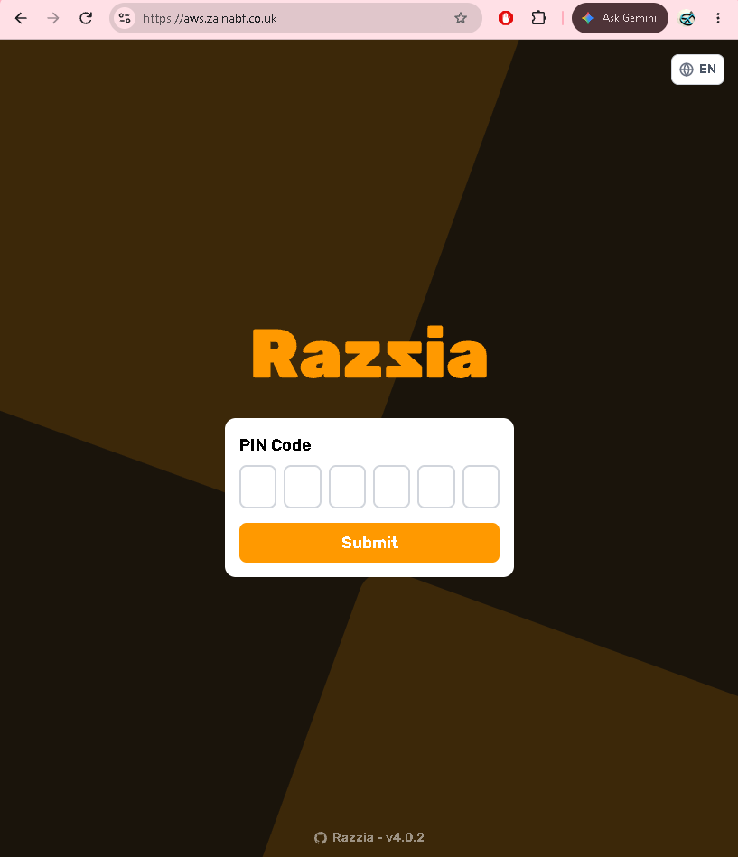

  With `https://aws.zainabf.co.uk/manager` ->  check if password works:
  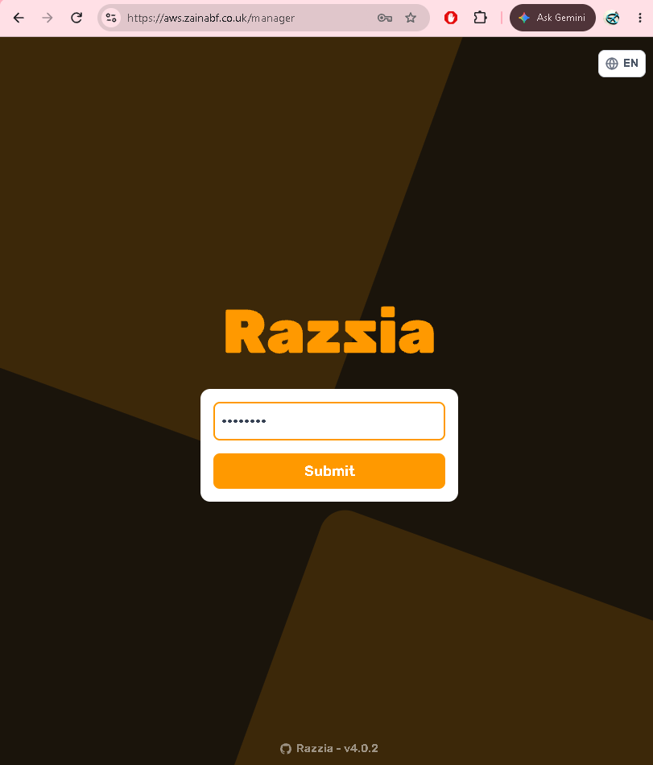


  **Works!!**

  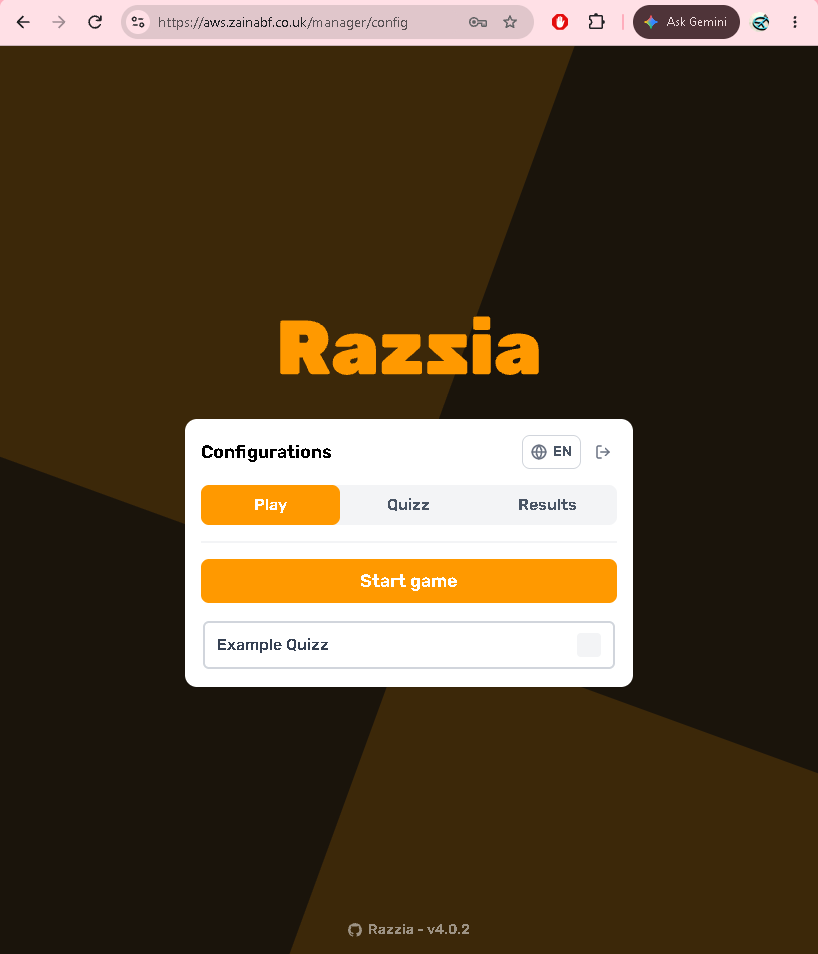


  If password wrong or not configured correctly: 

  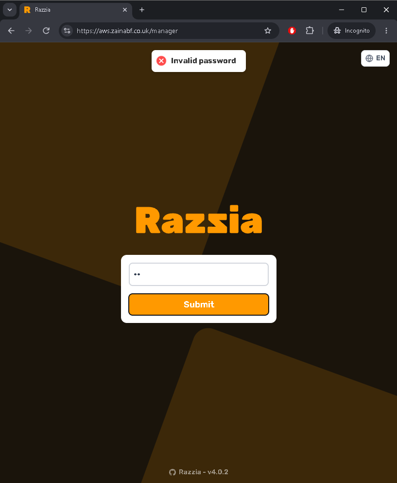


## Tearing it down

Destroy in this order:

1. **Main project** – from the `terraform` folder:

   ```bash
   terraform destroy
   ```

2. **Bootstrap (optional)** – only if you want everything gone. The state bucket costs very little, so it can be left in place for the next deployment.

   ```bash
   cd bootstrap
   terraform destroy
   ```

The main project's state lives in the bootstrap bucket. If the bucket is deleted first, Terraform loses track of what it built and everything would have to be removed by hand in the AWS console.

The Route 53 hosted zone is not managed by Terraform, so it stays in place and the Cloudflare setup keeps working.


<br/><br/>
<br/><br/>

### 07 - CI/CD Automation - Github Actions

Terraform creates the cluster, service, ALB, IAM roles and the first task definition.
After that, new images arrive through the pipeline

**Pre-reqs:**
  1. Bootstrap folder must be ran first. 
  2. Route53 must be set up (hosted zone created and NS records set up in Cloudflare custom domain)

1. Create a folder at root of the project folder called `.github/workflows`
2. Create a `pipeline.yaml` file in that folder. This is the actual cicd file.
   
3. Bootstrap folder needs the following: 
   - S3 remote backend 
   - ECR repo created
   - OIDC Configured - with IAM roles
   - IAM role for github identity to be able to push image to ECR repo
   - IAM role for terraform too - needs to be able to build and delete whole set up.
    - `ecr.tf` = ecr repo creation
    - `oidc.tf` = oidc setup and IAM roles 
    - `main.tf` = s3 remote state file set up
   

  **OIDC ->** Also need to be created in the bootstrap folder.
   
   - Once the workflow completes, the credentials expire automatically. 
  ```
  GitHub Workflow
        ↓
  OIDC Token
        ↓
  AWS STS
        ↓
  Assume IAM Role
        ↓
  Temporary Credentials
        ↓
  Push Image to ECR
  ```

  - **In Github actions workflow file: Need:** 

```yml
permissions:
  id-token: write
  contents: read
```

  - Without this, GitHub cannot obtain an OIDC identity token.


4. Need to manually run the bootstrap terraform config once and then every pipeline will use that. 
   - `terraform init` 
   - `terraform plan` 
   - `terraform apply --auto-approve`

 - Once that is complete, should have github role arn output in terminal - need this for the next part. Need to add the arn to the pipeline/workflow file:
 - Same thing for the role for terraform to be able to build and run anything. Arn also needs to be added to the workflow file. 


5. Authenticating to AWS with OIDC: In the workflow file:
  - Add the role arn created from bootstrap file.
```yml
    - name: Configure AWS Credentials
      uses: aws-actions/configure-aws-credentials@v4
      with:
        role-to-assume: arn:aws:iam::843447001879:role/github-actions-role
        aws-region: eu-west-1
```
  - Similar thing for the AWS terraform role too. 
  

6. Adding ECR login to the workflow file too
  
```yml 
    
    - name: Login to ECR
      uses: aws-actions/amazon-ecr-login@v2

```


<br/><br/>
<br/><br/>

### 08 - HTTPS and Domain Validation


<br/><br/>
<br/><br/>

## App Demo (with HTTPS visible in the browser)


<br/><br/>
<br/><br/>

## Pipeline Screenshots (all pipelines should show as working)


