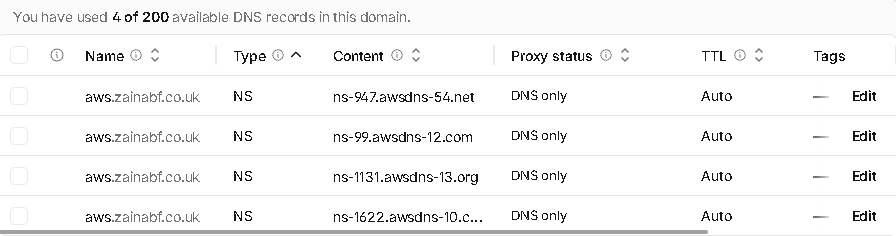
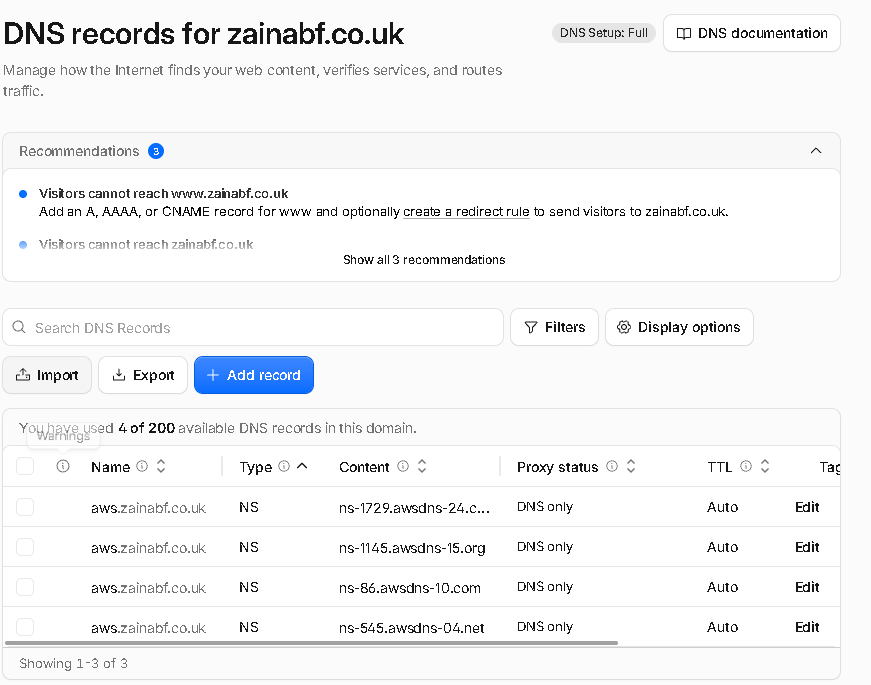

# Razzia on AWS ECS – Terraform Deployment

This folder contains the Terraform code that deploys the **Razzia** app to AWS. The app runs in a container on **ECS Fargate**, sits behind an **Application Load Balancer**, and is served over **HTTPS** on a custom domain:

**https://aws.zainabf.co.uk**

---

## How traffic reaches the app

```
Visitor
   │
   ▼
aws.zainabf.co.uk  (Cloudflare → Route 53)
   │
   ▼
Application Load Balancer  (public subnets)
   ├── HTTP  (port 80)  → redirects to HTTPS
   └── HTTPS (port 443) → uses the ACM certificate
                │
                ▼
         Target group (port 3000, health check on /)
                │
                ▼
         ECS Fargate task (private subnet, app on port 3000)
                │
                ▼
         NAT Gateway → internet (for outbound downloads and updates)
```

---

## Folder structure

```
terraform/
├── bootstrap/                # One-time setup, run before the main project
│   ├── .gitignore            # Stops state files being uploaded
│   ├── .terraform.lock.hcl   # Locks provider versions
│   ├── main.tf               # Creates the S3 state bucket and writes backend.hcl
│   ├── outputs.tf            # Shows key details after it runs (e.g. bucket name)
│   └── variables.tf          # Input settings for bootstrap
├── modules/                  # Reusable building blocks for the infrastructure
│   ├── acm/                  # SSL certificate so the site works over HTTPS
│   ├── alb/                  # Load balancer that sends visitors to the app
│   ├── dns/                  # Domain records (points the domain at the load balancer)
│   ├── ecs/                  # Runs the app in containers
│   └── networking/           # VPC, subnets and network setup
├── .gitignore                # Stops secrets and state files being uploaded
├── .terraform.lock.hcl       # Locks provider versions
├── backend.hcl               # Tells Terraform where the state is stored (made by bootstrap)
├── main.tf                   # Connects all the modules together
├── provider.tf               # AWS provider and backend settings
├── README.md                 # Documentation
└── variables.tf              # Input settings for the project
```

---

## What each part does

### Bootstrap – remote state

Terraform keeps a record of everything it builds, called the **state file**. Instead of keeping this on my laptop, it is stored in an **S3 bucket** so it is safe and not lost.

The `bootstrap` folder:

- Creates the S3 bucket for the state file
- Writes a `backend.hcl` file into the main `terraform` folder containing the bucket name, the state file path (`ecsproject/terraform.tfstate`), the region and `use_lockfile = true`
- `use_lockfile = true` stops two people from changing the infrastructure at the same time

The main project's `provider.tf` contains an empty `backend "s3" {}` block. The details are filled in from `backend.hcl` when running `terraform init`.

### Networking module

Sets up the underlying network:

- **VPC** – `10.0.0.0/16`
- **Subnets**
  - 2 public subnets in different Availability Zones (for the ALB and NAT Gateway)
  - 1 private subnet (for the ECS task)
- **Internet Gateway** – lets internet traffic reach the ALB
- **NAT Gateway** (in a public subnet) – lets the private container reach the internet for downloads and updates
- **Route tables**
  - Public route table: sends internet-bound traffic to the Internet Gateway
  - Private route table: sends internet-bound traffic to the NAT Gateway

### ALB module

- **Application Load Balancer** across the 2 public subnets, internet-facing
- **Security group** – allows HTTP (80) and HTTPS (443) from anywhere
- **HTTP listener (80)** – redirects visitors to HTTPS
- **HTTPS listener (443)** – uses the ACM certificate and forwards visitors to the target group
- **Target group** – sends traffic to the app on port 3000, with a health check on `/`

### ECS module

- **ECS cluster** using **Fargate**, so there are no servers to manage
- **Task definition** – instructions for the container:
  - Uses the app image from the private ECR repository `razzia`
  - App listens on port **3000**
  - Reads the manager password from Secrets Manager as the `MANAGER_PASSWORD` environment variable
- **ECS service** – keeps the container running and registers it with the load balancer's target group
- **Security group** – only allows traffic from the ALB's security group, so the container can't be reached directly from the internet
- **Task execution role (IAM)**:
  - `AmazonECSTaskExecutionRolePolicy` – lets ECS pull the image from ECR and write logs to CloudWatch
  - An extra policy allowing `secretsmanager:GetSecretValue` on the app password secret only

### Secrets Manager

The app's manager password is stored in **AWS Secrets Manager** as `razzia-app-password`.

- The password value comes from the `app_password` variable, set in `terraform.tfvars`
- `terraform.tfvars` is ignored by Git, so the password is never uploaded to GitHub
- `recovery_window_in_days = 0` means the secret is deleted immediately on `terraform destroy`, so there is no name clash when deploying again

### ACM module – HTTPS certificate

- Requests an SSL certificate for `aws.zainabf.co.uk` using **DNS validation**
- Creates the CNAME validation record in Route 53 automatically
- Waits until AWS approves the certificate before it is attached to the HTTPS listener
- `create_before_destroy = true` means a replacement certificate is created before the old one is removed, so the site is never without HTTPS

### DNS module

- Uses a **pre-created Route 53 hosted zone** for `aws.zainabf.co.uk` (see Prerequisites)
- Looks up the zone with a `data` block, so Terraform never creates or deletes it
- Creates an **A (alias) record** pointing `aws.zainabf.co.uk` at the load balancer

---

## Prerequisites

1. **Terraform** and the **AWS CLI** installed, with AWS credentials configured

2. **Route 53 hosted zone** – created once, outside Terraform
   - Create a hosted zone in Route 53 called `aws.zainabf.co.uk`
   - Copy the 4 NS (nameserver) records AWS gives you into Cloudflare

   

   - This only needs doing once. Because Terraform uses the existing zone rather than creating it, every `terraform destroy` and `terraform apply` keeps working without touching Cloudflare again.

3. **ECR repository** – the private repository `razzia` with the app image pushed to it

4. **`terraform.tfvars`** – create this file in the `terraform` folder with the app password:

   ```hcl
   app_password = "your-password-here"
   ```

---

## Deployment steps


### 1. Make sure Route53 Hosted Zone is created. 
   - Set up Route53 hosted zone before terraform deployment. 
   - In cloudflare - add the NS records for the hosted zone. 
   


### 2. Create the remote state bucket (first time only)

```bash
cd terraform/bootstrap
terraform init
terraform plan
terraform apply
```

This creates the S3 bucket and writes `backend.hcl` into the `terraform` folder.

### 3. Connect the main project to the S3 backend

```bash
cd ..
terraform init -backend-config=backend.hcl -migrate-state
```

- `-backend-config=backend.hcl` tells Terraform where the state bucket is. Plain `terraform init` won't read the file by itself.
- `-migrate-state` copies any existing local state into S3. Type `yes` when asked.

After this first time, a plain `terraform init` is enough.

### 4. Deploy

```bash
terraform plan
terraform apply
```

### 5. Push the app to the ecr repo through the CLI.
- Make sure docker engine is open locally.  
- Get the push commands from ECR repo created in the AWS portal. 
- `aws ecr get-login-password --region eu-west-1 | docker login --username AWS --password-stdin 843447001879.dkr.ecr.eu-west-1.amazonaws.com`
- `docker build -t razzia-app .`
- `docker tag razzia-app:latest 843447001879.dkr.ecr.eu-west-1.amazonaws.com/razzia-app:latest`
- `docker push 843447001879.dkr.ecr.eu-west-1.amazonaws.com/razzia-app:latest`

### 6. Check it works

Go to **https://aws.zainabf.co.uk** – the Razzia PIN page should load with a padlock in the browser.

---

## Screenshots

**Home page**


**Manager login**


**Wrong password is rejected**


**Manager configuration page after logging in**


---

## Tearing it down

Destroy in this order:

1. **Main project** – from the `terraform` folder:

   ```bash
   terraform destroy
   ```

2. **Bootstrap (optional)** – only if you want everything gone. The state bucket costs very little, so it can be left in place for the next deployment.

   ```bash
   cd bootstrap
   terraform destroy
   ```

The main project's state lives in the bootstrap bucket. If the bucket is deleted first, Terraform loses track of what it built and everything would have to be removed by hand in the AWS console.

The Route 53 hosted zone is not managed by Terraform, so it stays in place and the Cloudflare setup keeps working.

---

## Files not in this repo

These are ignored by Git on purpose:

| File | Why it's ignored |
|---|---|
| `terraform.tfvars` | Contains the app password |
| `terraform.tfstate` / `.backup` | Can contain secrets in plain text; the real state lives in S3 |
| `.terraform/` | Downloaded providers and modules, recreated by `terraform init` |